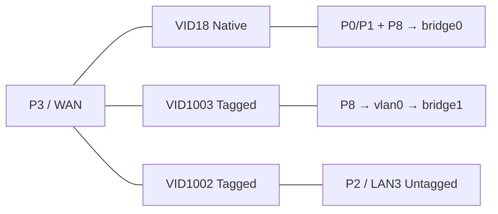

# 已驗證案例：三個廣播網域

本頁保留 **A1470（2013款）、韌體7.9.1** 的實機可用案例，作為通用設計的對照。部署仍需既有SSH存取權限；本專案不提供如何開啟 SSH 的方法。本案例中的VID1002與LAN3不是整個專案的必要設定。

| 網域 | WAN／P3 | 其他成員 | CPU路徑 |
|---|---|---|---|
| Native／內部VID18 | Untagged | LAN1、LAN2、主Wi-Fi | P8／`bcmeth0` → `bridge0` |
| Guest／VID1003 | Tagged | Guest Wi-Fi | P8 Tagged → `vlan0` → `bridge1` |
| VID1002 | Tagged | LAN3／P2 Untagged | 無CPU membership，ASIC直接轉送 |

第三網域不建立 `bridge2`／`vlan1`。LAN3是面對機背三個LAN孔最下方、USB正上方的插孔，已由使用者確認位置，並由原研究拔插測試確證ASIC P2。P0/P1對應LAN1/LAN2的個別順序未驗證。

## 參數對照

| 項目 | 原廠基線 | 案例目標 |
|---|---:|---:|
| Control4 | `0xC4` | `0x40` |
| Control5 | `0x10` | `0x18` |
| VID18 Entry | `0x00221F0F` | `0x0022170B` |
| VID1002 Entry | `0` | `0x0020080C` |
| VID1003 Entry | `0` | `0x00200108` |
| P2 PVID／Mask | `18 / 0x010F` | `1002 / 0x000C` |
| P3、P8 PVID／Mask | `18 / 0x010F` | 保留 |

Native目標 `M=U={0,1,3,8}`；1002目標 `M={2,3},U={2}`；1003目標 `M={3,8},U={}`。通用規劃器的回歸測試能重算這三個Entry；案例保留較寬的P3/P8 Mask，不能把由聯集推導的最小Mask與實測寄存器原值混為一談。

## 固定實作入口

[airport-dot1q-test.c](../../src/airport-dot1q-test.c)及[airport-three-vlan-service.sh](../../scripts/airport-three-vlan-service.sh)保留原樣，使用固定VID、P2及介面前置條件。它們不讀取通用JSON profile，`three-vlan-service`建置模式始終產生本案例的配置。

要重現本案例，參考[固定案例建置及服務](validated-service.md)。要設計不同拓撲，參考[通用流程](../configuration-guide.md)、[profile範例](../profiles-and-examples.md)及[移植步驟](../build-and-service.md)。不要只修改 `TEST_VID` 就以為所有白名單、literal、回復與軟體狀態已一起改動。

## 驗收範圍

原始端點證據證明：LAN3的Untagged輸入及同VID1002 Tagged輸入可通行；VID18、1003、4094負向輸入未跨域。下行1002到LAN3去Tag，frame及Linux AUXDATA均無VLAN；Native／Guest負向幀未到LAN3，同窗口有正向控制。

另外有配對DHCP四步交換、IPv4／IPv6連通及實際重新啟動後的恢復證據。四個Wi-Fi介面維持，主5GHz／Guest2.4GHz有端點流量證據；主2.4GHz／Guest5GHz完整端點驗收及實體冷開機仍未完成。完整驗證範圍與限制見[驗證文件](../validation.md)。

這些結果只證明本案例，不涵蓋所有VID、埠組合、Tag admission或其他韌體。歷史校準亦修正了「ASIC鏡像Service Tag等於實體線路封裝」的推論；去Tag驗收應依端點實際訊框及metadata。
