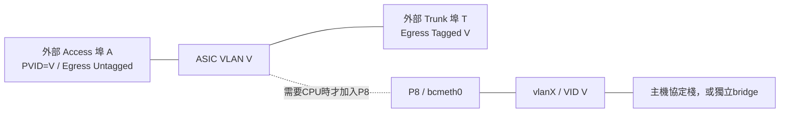

# 軟體介面、資料路徑與 Linux 對照

接孔位置見[機背圖](ports-and-layout.md)；VID、Access及Trunk的選擇見[通用設計](configuration-guide.md)。以下使用V或VID400說明，介面名稱中的序號不代表VID。

## Linux 與 NetBSD 的分工

| 想要的功能 | Linux 概念 | AirPort 對應 |
|---|---|---|
| CPU以某VID收發 | `ip link ... type vlan id V` | `ifconfig vlanX create`後設定 `vlan V vlanif bcmeth0` |
| 軟體介面橋接 | Linux bridge | `ifconfig bridgeX create`、`brconfig bridgeX add ...` |
| Untagged ingress分類 | Port PVID | ASIC每埠PVID |
| 指定VID無標籤送出 | per-VLAN egress untagged | ASIC VLAN Table Untag bitmap |
| 埠加入指定VLAN | VLAN membership | ASIC Table Members bitmap |
| 埠間允許轉送集合 | Port forwarding mask | ASIC Port VLAN Mask |
| 違規與未知VID過濾 | VLAN ingress filtering | ASIC Control4／Control5及完整成員表 |

AirPort未提供每個RJ45的獨立NetBSD ifnet，所以沒有可直接用 `ifconfig lan1` 等方式操作的實體埠。`bcmeth0`是CPU端共享parent，實體埠的設定要到SRAB層。

## 決定是否需要 CPU



純外部交換時，`M(V)`只包含Access／Trunk資料埠，不加入P8。ASIC即可加Tag、去Tag與依VID隔離，不需要軟體子介面或bridge。

CPU主機、Wi-Fi或軟體橋需參與時，將P8納入成員，通常保持Tagged，才能讓parent區分多個VID。這時才使用下列軟體配置。若硬體表未讓該VID到達CPU，即使子介面建立成功也不會自動取得連通性。

## 建立任意 VID 的 CPU 子介面

Linux示例：

```sh
ip link add link eth0 name eth0.400 type vlan id 400
ip link set eth0.400 up
```

NetBSD對應語法如下；假設硬體已允許CPU Tagged400，而且 `vlan1` 尚未使用：

```sh
ifconfig vlan1 create
ifconfig vlan1 vlan 400 vlanif bcmeth0 up
```

`vlan`與`vlanif`要在同一次設定中給出。VID可以換成設計值，`vlan1`則改成未占用的VLAN介面名稱。傳到子介面的訊框由parent以該VID送出；parent收到同VID的Tag流量則分配給對應子介面。語法與機制見 [NetBSD 6 ifconfig(8)](https://man.netbsd.org/NetBSD-6.0/ifconfig.8)。

若只需CPU端點，可由管理者在這個子介面設定主機網路參數；該IP規劃不由VLAN機制自動提供。若要橋接，將子介面加入獨立橋；不要把應隔離的VLAN子介面放進同一個橋。

```sh
# bridge2也必須尚未使用；這裡只建立橋的骨架。
ifconfig bridge2 create
brconfig bridge2 add vlan1
brconfig bridge2 up
```

只有一個成員的bridge不會接到其他實體孔。要連Wi-Fi或其他軟體介面，另確認那些介面的用途與原有成員關係，再設計橋接。不能將同一無線介面同時當作兩個隔離網域的普通bridge成員。

回復自己建立的示例介面時，依序解除成員再銷毀：

```sh
brconfig bridge2 delete vlan1
ifconfig bridge2 destroy
ifconfig vlan1 destroy
```

這些範例不修改既有 `vlan0`、`bridge0`、`bridge1`、PF或SSID。原廠服務的變動要另設計遷移與回復，不能將示例命令套到占用中的介面。

## CPU／Wi-Fi 的原廠基線參考

研究基線觀察為：

```text
P8 ↔ bcmeth0
 ├─ Untagged ─────────── bridge0 ─ wlan0 / wlan2（主網路）
 └─ Tagged VID1003 ───── vlan0 ─── bridge1 ─ wlan1 / wlan3（Guest）
bcmeth1：另一內部CPU介面，案例保持Down
```

`vlan0`實際VID為1003，不是VID0。此設備wlan0/wlan2分別為主5GHz／2.4GHz，wlan1/wlan3分別為Guest5GHz／2.4GHz。這是已盤點的基線，並非通用VID或SSID命名規則。

若新profile保留既有服務，沿用其成員與VID並加入所需的新成員表；若要改Guest VID，需同步修改其軟體子介面及原廠ACPd配置／初始化行為。本研究沒有完成任意新增SSID或任意Guest VID持久變更的驗收，不能只改ASIC表就假定Wi-Fi已同步。

盤點命令如下；它們不能代替ASIC與封包驗收：

```sh
/sbin/ifconfig -a
/sbin/brconfig bridge0
/sbin/brconfig bridge1
/usr/bin/netstat -rn -f inet
```

## 兩個方向的標籤處理

Access上行：Untagged進A → 依 `PVID(A)=V` 分類 → 檢查A為V成員及Port Mask → 送到Trunk T；T不在 `U(V)`，因此以Tagged V送出。

Trunk下行：Tagged V進T → 依VID查表 → 檢查來源／出口成員 → 送到Access A；A在 `U(V)`，因此去Tag。CPU若也在此VLAN，依CPU自己的Untag設定處理，與外部Access的出埠封裝無關。

VID不是改寫IP子網的規則，也不自動建立路由、NAT或DHCP。外殼的WAN標籤與Linux介面命名不決定VLAN角色。

## 隔離與觀測

PVID只決定預設分類，Untag只決定出口形式。要隔離其他VID，還需將Access埠從那些VLAN的成員表移除，啟用並驗證來源違規／table miss過濾。同VID Tagged輸入通常仍可通行；只准Untagged ingress屬於另一項frame admission需求。

優先級VID0、多層Tag、未知單播／多播等行為須有各自測試。純ASIC流量不必經CPU，所以 `tcpdump -i bcmeth0` 沒抓到，不等於實體埠之間沒轉送。

原廠DT模式的ASIC Mirror曾在Untagged原幀外加 `0x9100/18`；不能由鏡像推論端點自行Tag或物理線路一定QinQ。驗收Egress Untagged應看終端實收訊框；Linux AF_PACKET還要用 `PACKET_AUXDATA` 檢查可能被卸除的VLAN header metadata。

## MTU 與校驗

802.1Q增加Ethernet層4 bytes，不代表IP MTU必須減4。標準1500-byte VLAN MTU要求parent／硬體承載較大Ethernet frame，通用限制見 [NetBSD 6 vlan(4)](https://man.netbsd.org/NetBSD-6.0/vlan.4)。

本設備相關軟體介面已盤點為MTU1500，固定案例未修改MTU或ASIC最大幀長。純ASIC VLAN不會因改CPU parent MTU就向外部端點宣告較小IP MTU。新拓撲仍應測試所需幀長，不能把介面讀值或小包成功當作大包驗收。

原研究只觀察到bcmeth的LRO4 capability，沒有可見的UDP／TCP／IPv4 checksum offload能力。通用設計不要求修改這些offload設定；封包校驗應在正確收發位置核對。
